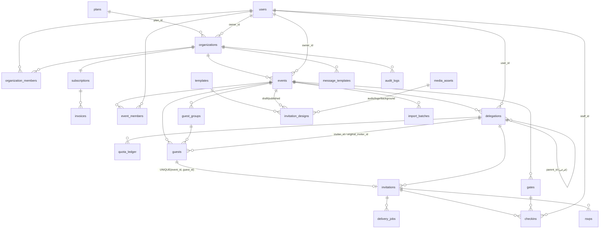

# نموذج البيانات (ERD) — DAWAT

المخطط الكامل: `db/migrations/001_init.sql` (22 جدولًا). كل جدول تابع للعميل يحمل
`organization_id` مباشرة أو عبر علاقة محققة، مع فهارس على event_id/delegation_id/status/created_at.

## الجداول والحقول المحورية

| الجدول | حقول محورية | ملاحظات/قيود |
|---|---|---|
| plans | id, name_ar, price_monthly_sar, max_active_events, max_guests_per_event, max_delegates_per_event, storage_mb | 4 باقات مبذورة |
| users | id, email UNIQUE, phone UNIQUE, password_hash(scrypt), status, is_platform_admin | بريد أو هاتف إلزامي |
| sessions | id=sha256(token), user_id, expires_at | لا رمز خام |
| organizations | id, name, kind, plan_id, owner_id, retention_days | مساحة عمل فرد/مؤسسة |
| organization_members | (org_id, user_id) PK, role owner/admin/member | عضوية مستقلة |
| subscriptions | org_id UNIQUE, plan_id, state, billing_cycle, renewal_at | |
| invoices | subscription_id, amount_sar, tax_sar, status, provider_ref | |
| events | id, org_id, owner_id, type, timezone, starts_at/ends_at UTC, capacity, quota_unit(card/person), unit_locked, cancel_returns_quota, allow_reentry, rsvp_deadline, status | حالات: draft→ready→published→ongoing→ended→archived + cancelled |
| event_members | event_id, user_id, role(owner/manager/supervisor/delegate/receptionist/designer), permissions JSON | UNIQUE(event,user,role) |
| gates | event_id, name | بوابات الاستقبال |
| delegations | event_id, parent_id, user_id, invitee_name/phone/email, quota_allocated, quota_used, permissions JSON, status, expires_at, suspended_policy | CHECK quota_used ≤ quota_allocated |
| quota_ledger | delegation_id, invitation_id, delta, balance_after, reason, note, actor_id | allocation/issue/cancel_return/cancel_burn/reallocate_out/in/adjust |
| guest_groups | event_id, name UNIQUE, kind, companion_max, is_vip | VIP/أفراد/عائلات/شركات/مخصص |
| guests | event_id, inviter_id, original_inviter_id, group_id, name, phone, phone_hash, conflict, import_batch_id | UNIQUE(event_id, phone_hash) جزئي |
| invitations | event_id, guest_id, delegation_id, token_hash UNIQUE, token_nonce, status, persons_reserved, companions_allowed, issued_at, expires_at, idempotency_key | UNIQUE(event,guest) + UNIQUE(delegation,idempotency_key) |
| rsvps | invitation_id, answer(confirmed/declined), persons_confirmed, message, occurred_at | سجل تاريخي — آخر رد هو الفعال |
| checkins | invitation_id, event_id, gate_id, staff_id, persons, mode(scan/manual), manual_reason, is_reentry | |
| templates | org_id(NULL=عام), name_ar, style, visibility, version, schema_json | 6 قوالب عامة مبذورة |
| media_assets | org_id, owner_id, event_id, kind, mime, bytes, storage_key, rights_attested, status | soft delete |
| invitation_designs | event_id, template_id, scenes_json, version, state(draft/published), audio_asset_id | UNIQUE(event,state) |
| delivery_jobs | invitation_id, channel, state, provider_ref, attempts, idempotency_key | manual_sent في MVP |
| message_templates | org_id, name, body | معاملات {اسم_الضيف}/{رابط_الدعوة}/{اسم_المناسبة} |
| audit_logs | org_id, event_id, actor_id, action, object_type/id, detail_json, ip | بلا رموز خام |
| idempotency_keys | (scope,key) PK, result_json | issue_invitation/scan |
| import_batches | event_id, total_rows, inserted, skipped_duplicates, errors_json | سجل أخطاء الصفوف |

## ملاحظات أمنية على المخطط

- `token_hash` بدل الرمز الخام دائمًا؛ `token_nonce` يتيح إبطال/إعادة إصدار.
- الهاتف مخزن نصيًا للإرسال اليدوي في MVP — **الإنتاج: تشفير عمود phone أثناء التخزين** مع بقاء phone_hash للتطهير.
- عزل المستأجرين مفروض في طبقة الخدمات؛ عند الترحيل لـ Postgres تُضاف RLS كدفاع ثانٍ.
- التواريخ UTC ISO مع timezone للعرض (هجري/ميلادي عبر Intl).

## Expansion — جداول التخطيط (ليلتنا, migration 002)
`event_plans` · `planning_templates` · `budget_categories` · `expenses` · `payments` ·
`tasks` · `checklists` · `checklist_items` · `vendors` · `attachments` · `timeline_items` · `planning_team`.
كلها تتبع `event_id` (علاقة محققة) + `organization_id`؛ `planning_team` يسمح بأكثر من دور للشخص نفسه.
الفصل المالي: `expenses.status` (فعلي/مخطط) منفصل عن `payments.status` (مدفوع/مستحق) — راجع `docs/PLANNING_MODULES.md`.